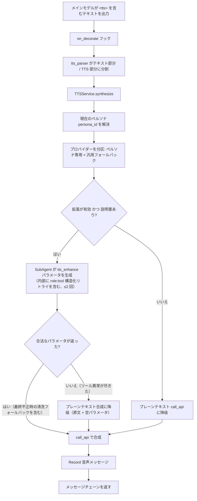

# TTS Enhancer アーキテクチャドキュメント

> 本ドキュメントは、プラグインの内部メカニズムを深く理解したい開発者・メンテナー向けです。
> 関連ドキュメント：[開発ガイド](DEVELOPMENT.md) · [既知の制限と上流の責任](KNOWN_LIMITATIONS.md) · [English README](../en/README.md) · [CHANGELOG](../../CHANGELOG.md)

---

## 1. 設計目標と位置づけ

AstrBot のメインモデル（LLM）はデフォルトでは TTS 処理にプレーンテキストしか渡せません。しかし現代の音声合成サービスは、感情タグ、自然言語指示、方言、ボイスクローニング、サウンドデザインなど、すでに豊富な機能をサポートしています。TTS Enhancer の位置づけは、**「従来のテキスト入力」と「プロバイダーの豊富な機能」との間のギャップを埋めること**であり、**高い拡張性**で任意の音声サービスに接続し、コアコードを変更せずに済むようにすることです。

コア設計原則：

- **高い拡張性を持つマルチプロバイダーアーキテクチャ**：各プロバイダーは独立したアダプター（Adapter）であり、互いに干渉せず、新しいプロバイダーはそのまま追加できます。
- **ケイパビリティドキュメントの仕組み（Capability Docs）**：各プロバイダーにパラメータと使い方を記述した Markdown ドキュメントが付属し、SubAgent はそれに基づいて「範囲を逸脱しない」最適なパラメータを動的に生成します。
- **オンデマンドなフロントエンド**：公式 Web コンソールのないプロバイダーにのみ再利用可能な管理コンポーネントを提供；コンソールを持つプロバイダーは外部リンクへ直接遷移させ、重複実装を避けます。
- **防御的な境界**：ファイル ID、ルートパラメータ、アップロード拡張子、API Key の取り扱いなどに明示的なセキュリティ制約を設けています。

---

## 2. 全体アーキテクチャ

プラグインは AstrBot のイベントパイプラインにおいて「結果のデコレーション」段階に位置し、全体は 4 層に分かれます。

```
┌──────────────────────────────────────────────────────────────────────┐
│  メインモデル (LLM)                                                    │
│  - <tts>…</tts> タグを出力（または Agent Tool 経由で能動的に呼び出し）     │
│  - on_llm_req で TTS トリガーのプロンプトを注入                          │
└───────────────────────────────┬──────────────────────────────────────┘
                                 │
┌───────────────────────────────▼──────────────────────────────────────┐
│  TTS Enhancer プラグイン (main.py / src/*)                             │
│  - on_decorate でタグを解析 → テキスト部分と TTS 部分に分割              │
│  - TTSService が合成、コンテキスト、ペルソナルーティング、               │
│    マルチプロバイダーフォールバックを調整                                │
│  - SendVoiceTool が send_voice_to_user 能動音声ツールを提供             │
│  - Web API ルート（音色 / ファイル管理、アップロード、KV）               │
└───────────────────────────────┬──────────────────────────────────────┘
                                 │
┌───────────────────────────────▼──────────────────────────────────────┐
│  TTSSubAgent (src/sub_agent.py)                                        │
│  - 拡張モデル Provider を呼び出し（enhance_llm_provider を指定可能）     │
│  - ケイパビリティドキュメント + ペルソナ + コンテキストを注入 →           │
│    tts_enhance ツール経由で構造化パラメータを生成                        │
└───────────────────────────────┬──────────────────────────────────────┘
                                 │
┌───────────────────────────────▼──────────────────────────────────────┐
│  Provider Adapter (providers/*)                                        │
│  - パラメータを検証 / 清洗 → 実際の TTS API を呼び出し → 音声を落盤       │
│  - 任意：音色管理（クローン / デザイン / 一覧 / 削除）、ファイル管理       │
│  - 自動検出 + ファクトリによるインスタンス生成                           │
└──────────────────────────────────────────────────────────────────────┘
```

フロー化した観点から 1 回の完全な合成を見ることもできます：



---

## 3. リクエストライフサイクル（エンドツーエンド）

2 つのトリガー経路が存在し、最終的にどちらも `TTSService.synthesize()` に集約されます。

### 3.1 タグトリガー経路（デフォルト）

1. **`on_llm_req`**：プロバイダーが設定済みで `tts_prompt` も設定されている場合、トリガープロンプトをシステムプロンプトに追加し、メインモデルが合成対象テキストを `<tts>…</tts>` で包むよう促します。
2. **`on_decorate`**（`priority=13`）：メッセージチェーンの `Plain` テキストコンポーネントを走査し、`<tts>` タグが含まれていれば：
   - `tts_service.get_context_messages(event)` を呼び出して直近 `context_window` ターンのコンテキストを取得；
   - タグを含むテキストに対して `_process_tts_text()` を呼び出し、部分ごとに処理；
   - `split_by_tts_tags()` でテキストを `text` 部分と `tts` 部分に分割。`text` 部分は `Plain` として保持し、`tts` 部分は `synthesize()` に渡す；
   - 合成成功時は `Record` コンポーネントを返し（任意で `dual_output` により原文も保持）、失敗時は `Plain` テキストに降级。

### 3.2 ツールトリガー経路（Agent Loop）

1. プラグインは `__init__` で `context.add_llm_tools(SendVoiceTool(...))` により `send_voice_to_user` ツールを登録（`src/tools.py` に定義）。
2. モデルは Agent ループ内でこのツールを能動的に呼び出し、`text`（および任意の `session`）を渡す。
3. ツール内部でコンテキストを取得し、`tts_service.synthesize()` を呼び出し、`star_context.send_message()` で音声メッセージを対象セッションに送信。

2 つの経路は同じ `TTSService` インスタンス（`main.py` で構築し、`context / providers / config / audio_data_dir` を注入）を共有します。

---

## 4. コアモジュールの分解

### 4.1 `main.py` — プラグインのエントリーポイント

責務：初期化、イベントフック、Web API ルート、セキュリティ検証。

- **`TTSEnhancerPlugin(Star)`**：ライフサイクルのエントリーポイント。データディレクトリ（`plugin_data/<name>/{uploads,audio}`）を初期化し、`TTSService` を構築、`SendVoiceTool` を登録、すべての Web ルートを登録。
- **イベントフック**：
  - `on_llm_req`：TTS プロンプトを注入。
  - `on_decorate`：`<tts>` タグを解析して置換。
- **Web API**（すべて `/<plugin_name>/` プレフィックス下、セキュリティ設計は第 10 節を参照）：
  - `GET /providers`：`template_key` ごとにグループ化したプロバイダー一覧を返し、`api_key` はマスキング。
  - `POST /voice/{create,list,delete}`：ボイス管理。`entry_id` に基づいてアダプターへルーティング。
  - `POST /upload`：ローカル音声のアップロード（拡張子ホワイトリスト）。
  - `POST /voice/preview`：ボイスのプレビュー（Base64 で返す）。
  - `POST /kv/{set,get,delete}`：汎用 KV ストレージ（フロントエンド / アダプターがメタデータを読み書き）。
  - `POST /file/{upload,list,get,delete}`：プロバイダーのファイル管理（`**kwargs` を透過的に渡す）。
- **セキュリティ補助**：`_SAFE_FILE_ID_RE`、`_validate_file_id()`、`_resolve_uploads_path()`（resolve 後に親ディレクトリを比較してトラバーサルを防止）、`_parse_entry_id()`（型と範囲を検証し、`bool` を除外）。

### 4.2 `src/config.py` — 設定管理

`TTSEnhancerConfig` は設定のロードと正規化を担当します：

- `_load_providers()`：`priority` で安定ソート（値が小さいほど優先）；`priority` の重複と `display_name` の重名を検出（重名の場合は `#2`、`#3` のサフィックスを自動付与し、プライベートフィールド `__resolved_name` に書き込む）。
- `get_providers()`：ソート済みのプロバイダー一覧を返す。
- `get_entry_name(entry, index)`：表示名の解決（優先順位：`__resolved_name` → `display_name` → `template_key (voice)` → `template_key #index` → `template_key`）。
- `get(key, default)`：トップレベルの設定項目を読み取る；`has_providers()`：プロバイダーが存在するか。
- `_to_priority_int()`：数値以外の `priority` は `100` にフォールバックして警告し、ソート時に `int/str` が混在して `TypeError` が発生するのを防ぐ。

### 4.3 `src/tts_parser.py` — タグ解析

`split_by_tts_tags(text)` は `<tts>…</tts>` を含むテキストを `{type: 'text'|'tts', content}` のリストに分割します：

- 文字列以外の入力は空リストを直接返す（例外を投げず「内容なし」として扱う）。
- 孤立した終了タグ、ネスト / 対応不全などのケースを処理；タグ内容から先頭・末尾の区切り文字と空白を除去。
- 有効な断片がまったくない場合は、タグを除去したテキストをプレーンテキストとしてフォールバック。
- 区切り文字定数：`BOUNDARY_SEPARATORS = "$"`（タグ境界の残骸を掃除するために使用）。

### 4.4 `src/tts_service.py` — 合成オーケストレーション

`TTSService` は合成フローの「総指揮」です：

- `get_context_messages(event)`：`conversation_manager` から直近 `context_window` 件の **user** メッセージをウィンドウとして取得（user 単位でカウント）、逆順に収集した後で時間順に戻す；例外が発生した場合は空リストに降级。
- `get_current_persona(event)`：現在のセッションで有効なペルソナを解決し、`(prompt, persona_id)` を返す；`conversation_manager` / `persona_manager` が未準備の場合は空に降级。
- `synthesize(raw_text, event, context_messages)`（コア）：
  1. ペルソナを解決 → プロバイダーを **ペルソナ専用**（`persona_id` が一致）と **汎用フォールバック**（`persona_id` なし）に分区し、順序付きで試行（専用を優先）。
  2. 候補が空の場合は Warning のみで、黙って失敗させない。
  3. 各エントリに対して：`_data_dir` を注入 → `ProviderFactory.get_adapter()` → `enable_enhance = config.enable_enhance and bool(docs_content)` と判定。
  4. **拡張なし / ドキュメントなし**：`raw_params={}` でそのままプレーンテキスト合成（LLM を無駄に 1 回呼ばないため）。
    5. **拡張経路**：`adapter.get_tool_schema()` で `ToolSet` を構築 → `sub_agent.call()` を呼び出し（内部で `max_attempts=2`）：
       - 返された構造は `adapter.validate_params()` で検証；検証失敗またはツール実行異常時は、`[assistant(tool_calls), tool(tool_call_id, content)]` を構築し、`role:"tool"` の構造化ツール結果（エラーテキストを含む）を `provider.text_chat(tool_calls_result=...)` で LLM へ再注入してリトライ；
       - 最終回の検証失敗でアダプターが清洗に対応している場合、`sub_agent.call()` は `sanitize_params()` で清洗したパラメータを返す；ツール異常が尽きた場合は `None` を返し、`tts_service` がプレーンテキスト合成（原文 + 空パラメータ）に降级。そのプレーンテキスト合成も失敗した場合に限り次のプロバイダーへ切り替える。
  6. SubAgent が空の `text` を返した場合は原文を保持；最終的に `call_api()` が成功すれば `Record.fromFileSystem(path, text=...)` を返し、失敗すれば次のプロバイダーへ切り替える。

### 4.5 `src/sub_agent.py` — SubAgent

`TTSSubAgent.call(...)` は LLM を呼び出して構造化された TTS パラメータを生成します：

- 拡張モデルの解決：`enhance_llm_provider` が指定されていれば ID で取得し、なければ現在のセッションの Provider を使用；取得できなければエラーとして `None` を返す。
- ユーザープロンプトを組み立て：ペルソナ + コンテキスト要約 + 合成対象テキスト。
- `provider.text_chat(..., func_tool=tool_set)` を呼び出し；`tools_call_name == 'tts_enhance'` の `tools_call_args` を優先して解析；
- ツール呼び出しがない場合は `completion_text` からの抽出に降级（`text` のみ）；最終的に失敗した場合は `None` を返す。
- リトライ機構：検証失敗またはツール実行異常時に、`[assistant(tool_calls), tool(tool_call_id, content)]` を `tool_calls_result` 経由で構造的に再注入（本物の `role:"tool"` オブジェクト単位のループ）し、プロンプトに平坦化しない；モデルがツール呼び出しを行わなかった場合に限り、`role:"user"` の軽いプロンプトで再呼び出しを促す。
- すべての例外は捕捉して記録し、決して上位へ送出しない。

### 4.6 `src/tools.py` — 能動音声ツール

`SendVoiceTool(FunctionTool)` は `send_voice_to_user` を公開します：

- パラメータ：`text`（必須）、`session`（任意、形式 `platform_id:message_type:session_id`）。
- `__post_init__` で `tts_service` が非空であることを検証；`call()` 内でコンテキストを取得し、`synthesize()` し、`star_context.send_message()` で送信。

### 4.7 `providers/` — アダプター体系

第 5 節を参照。

---

## 5. プロバイダーアダプター体系

### 5.1 抽象基底クラスのインターフェース契約（`providers/base.py`）

`TTSProviderAdapter(ABC)` はすべてのアダプターが実装すべき / 任意で実装できるインターフェースを定義します：

**抽象メソッド（実装必須）：**

| メソッド | 説明 |
|------|------|
| `get_subagent_system_prompt() -> str` | SubAgent に注入するシステムプロンプトを生成（通常はケイパビリティドキュメントを連結）。 |
| `get_tool_schema() -> FunctionTool \| None` | 基底クラスの `build_enhance_tool` を経由して `tts_enhance` ツールを返す（検証ハンドラが接続済み）；Function Calling 非対応の場合は `None` を返してよい。 |
| `call_api(text, raw_params, config, voice_id=None) -> str` | 合成して音声ファイルのパスを返す（空文字は失敗を示す）。`voice_id` はプレビュー時に音色を明示的に上書きするために使用。 |

**任意機能（デフォルトは `raise NotImplementedError`）：**

- ボイス管理：`create_voice(params)`、`list_voice(**kwargs)`、`delete_voice(**kwargs)`。
- ファイル管理：`upload_file(...)`、`list_files(**kwargs)`、`get_file_content(file_id)`、`delete_file(file_id, **kwargs)`。

**汎用ツール（基底クラスが実装済みで、そのまま利用可能）：**

- 型安全変換：`_as_float(value)`、`_as_int(value)`（LLM が文字列で返す数値にも対応、`bool` は除外）。
- 検証：`validate_voice_id(...)`（長さ 8〜256、先頭文字、文字セット、末尾の制約）、`_count_text_chars(text)`（CJK / 全角 / emoji を 2 としてカウント）、`validate_text_length(...)`（上記のカウントに基づく）。
- パラメータ処理：`validate_params(params) -> (bool, str)`、`sanitize_params(params) -> dict`（サブクラスでオーバーライドして具体的な範囲 / 列挙検証を実装）。

**ドキュメントとメタデータ：**

- `DOCS_KEY`（クラス属性、任意）：再利用するケイパビリティドキュメントを明示的に指定；未指定の場合は `template_key` にフォールバック。
- `docs_key` プロパティ、`_load_docs()`：`providers/docs/<docs_key>.md` から説明書を読み込む。
- `get_docs_for_voice(voice)`：音色 ID に応じて動的にドキュメントを選択可能（例：デザイン音色には `*_design.md`）。

### 5.2 自動検出とファクトリ（`providers/__init__.py`）

`ProviderFactory` は「ゼロ設定」のプラグイン化を実現します：

- `_discover_adapters()`：`providers/*.py` をスキャンし、**アンダースコアで始まるファイルと `base.py` をスキップ**；動的に `importlib` でインポート；`issubclass(obj, TTSProviderAdapter)` かつ `obj.__module__ == module.__name__` の具象クラスを収集（後者は基底クラスが多継承によって誤ったモジュール名に登録されるのを防ぐ）。
- `get_adapter(entry)`：`entry["__template_key"]` がモジュールファイル名（`.py` を除く）であり、これをマッピングキーとして使用；結果はクラス単位でキャッシュ。

> `__template_key` は AstrBot フレームワークが `template_list` 設定内で自動注入します；ファイル名とスキーマの `templates` キーは一致している必要があります。

### 5.3 共通基底クラス `BailianSpeechSynthesizerAdapter`

Bailian 系アダプターが共有する基底（`providers/_bailian_speech_synthesizer.py`、自動検出を避けるためアンダースコア接頭辞）：

- Alibaba Cloud Bailian の SpeechSynthesizer エンドポイント、Bearer 認証、リクエスト / レスポンス処理、音声ダウンロードをカプセル化。
- `MODEL_NAME`（例：`qwen-audio-3.0-tts`、`cosyvoice-v3.5`）と `VALID_LANGS` によって駆動され、サブクラスはこの 2 つとわずかな差異を宣言するだけで接続できます。
- `get_tool_schema()`（`tts_enhance`：text/instruction/volume/rate/pitch/language_hints）、`get_subagent_system_prompt()`、`call_api()`、`validate_params/sanitize_params`、`create_voice`（クローン / デザイン分岐）、`list_voice`、`delete_voice` を実装。
- `_extract_model_from_voice_id()`：クローン音色 ID から `flash/plus` を解析し、モデルのバージョン自動一致を実現。
- 初期化時に `entry` 内の `api_key` をマスキングして debug ログへの書き込みを防ぎ、`model` と音色 ID から解析した値が矛盾していないかをチェック。

具体的な Bailian アダプター（例 `bailian_qwen_audio_3_0_tts.py`）は数行程度で、`MODEL_NAME` などの差異のみを宣言します。

### 5.4 ケイパビリティドキュメントの仕組み

「ケイパビリティドキュメント」は SubAgent がインテリジェントにパラメータを生成する根拠であり、`providers/docs/<docs_key>.md` に格納されます：

- 内容には以下を含める必要があります：コアパラメータ表（型 / 範囲 / デフォルト値）、感情タグ / 方言 / 言語の列挙、使用例。
- **重要なセクション `## 你的任务`**：SubAgent に、コンテキストに基づいてパラメータを選択する方法と `tts_enhance` の呼び出し方を伝えます。
- デザイン音色（方言非対応）は個別に `<docs_key>_design.md` を使用し、`get_docs_for_voice()` が音色 ID に応じて自動的に切り替えます。
- 同じモデルのプロバイダーはサブクラスの `DOCS_KEY` で同じドキュメントを再利用できます（例：Bailian 版 MiniMax は公式 MiniMax ドキュメントを再利用）。冗長なコピーを避けます。

---

## 6. マルチプロバイダーフォールバックとペルソナルーティング

`TTSService.synthesize()` のプロバイダー選択戦略：

1. **ペルソナ分区**：現在の `persona_id` に基づき、プロバイダーを `bound`（そのペルソナにバインド）と `unbound`（未バインド）に分け、`bound` を先に順序付けて試行。
2. **フォールバックの意味論**：`bound` がすべて失敗し `unbound` が存在する場合、Warning の後に汎用音色へフォールバック；利用可能な音色が皆無、または専用音色が失敗してフォールバックもない場合は、Warning を出して今回の合成を断念（`None` を返す）。
3. **単一プロバイダー内のリトライ**：SubAgent のパラメータが不正またはツール実行が異常な場合、`role:"tool"` の構造化ツール結果を LLM へ再注入してリトライ（組み込みで最大 2 回）；最終回の検証失敗は `sanitize_params` で清洗してフォールバックし、ツール異常が尽きた場合はプレーンテキスト合成（原文）に降级。今回も失敗した場合に限り次のプロバイダーへ切り替える。
4. **プレーンテキスト降级**：拡張が無効、または説明書が欠如しているプロバイダーは、SubAgent をスキップして直接プレーンテキストで合成。

---

## 7. SubAgent 拡張機構

拡張フローのロバスト性設計：

- **構造化された出力**：`tts_enhance` Function Calling により、モデルに自由形式のテキストではなくパラメータオブジェクト（text/instruction/volume/rate/pitch/language_hints など）を出力させます。
- **2 段階の検証**：まず `validate_params`（範囲 / 列挙）→ 最終失敗時に `sanitize_params`（不正値を破棄し合法値を保持）。
- **コンテキスト認識**：直近の会話と `persona` プロンプトを SubAgent に注入し、感情 / 話速 / 言語の判断を文脈に即させます。
- **降级チェーン**：ツール呼び出し失敗 → テキスト解析への降级 → `None` を返す → メインフローがプロバイダーを切り替えるかプレーンテキストへ。
- **ドキュメントがなければプレーンテキスト**：「説明書のないプロバイダー」が LLM を無駄に走らせないことを保証。

---

## 8. フロントエンドアーキテクチャ（`pages/tts_studio/`）

フロントエンドは**ビルド不要**の Vue 3 アプリです：

- `index.html` は `<script>` でローカルの `static/vue.global.prod.js`（UMD、オフライン利用可、CDN 依存なし）を読み込み、`app.js` は `type="module"` でロード。
- `app.js`：
  - `bridge = window.AstrBotPluginPage`。すべてのバックエンド呼び出しは `bridge` を経由（`bridge.ready()`、`bridge.apiGet('providers')`、`bridge.upload` を含む）。Pages の `asset_token` 認証とクロスオリジンを回避。
  - `componentMap`：`template_key` を対応する Vue コンポーネントにマッピング；`getDisplayName()` が中国語ラベルを提供。
  - `template_key` ごとにタブをグループ表示し、現在のコンポーネントは `<component :is>` で動的にロード。`entries / bridge / template-key` を渡す。
- **コンポーネント構成**：
  - `components/common/`：プロバイダー間で共有するコンポーネント（`bailian_speech_synthesizer.js` はクローン / デザインの 2 モード（クローン音声はブラウザで Data URL にエンコードして送信）、`voice_preview_modal.js` はプレビューモーダル、`delete_confirm_modal.js` は削除確認）。
  - `components/*.js`：各プロバイダーの薄いラッパー。common コンポーネントを参照し、`providerConfig` で差異（言語一覧、ヘルプリンク、システムボイス対応可否など）を設定。
  - `composables/`：`useAudioManager`（グローバル音声シングルトン / 音量）、`useTextValidator`（漢字 = 2 文字のカウントと検証）、`useClipboard`、`useToast`。
- スタイルは `style.css` に集約；`eslint.config.mjs` がオプションの lint を提供（開発時のみ）。
- **設定可能な背景画像**：管理ページは設定項目 `page_background`（file 型）で単一の背景画像をアップロード可能；バックエンドの `/<plugin>/page-background` ルートが画像を base64 Data URL として読み出して返す（バイナリがブリッジを通ることとクロスオリジン / 外部リンクを回避）。フロントエンドの `applyPageBackground()` は `data_url` が空でない場合のみ `#page-bg` の固定背景レイヤーを描画し、`page_background_opacity` / `page_background_blur` に従って不透明度とぼかしを適用。コンテンツカードとフォーム項目も半透明のすりガラス風に変更し、背景が透けて見えるようにしています。
- **フローティングレイヤーアーキテクチャ（モーダル / Toast / 音量バー）**：グローバル音量バー、すべてのモーダルオーバーレイ、通知トーストは `<Teleport to="body">` で body 直下にマウント（fixed + `100vw/100vh`）。ページレベルのフェードインアニメーションは `animation-fill-mode: both` を使用し、終了後に祖先要素へ 2 種類の永続的な副作用を残します——合成トランスフォーム（computed transform が `none` ではなく単位行列となり、`position: fixed` の子孫の包含ブロックになる）と合成レイヤー（すなわち重ね合わせコンテキストで、サブツリー内の z-index を固定）。body への Teleport はこれら 2 つの副作用に対して堅牢なアーキテクチャであり、新しい浮層を追加する際はこれに従うべきです。
- **アニメーション規約**：一度きりの出入り（モーダル、ページ / タブの進入）はすべて `<Transition>` を使用——アニメーションクラスが再生されれば削除され、残骸が出ません。継続的なトランジション（タブのハイライトバー）は transform のコンポジターアニメーション + `will-change` を使用し、毎フレームのレイアウトを回避。`@media (prefers-reduced-motion: reduce)` 下ではすべて無効化。

> 設計上の取舍：API のみで UI のないプロバイダーの管理体験だけを補完する；公式コンソールを持つプロバイダーは外部リンクとし、重複実装しない。

---

## 9. 設定システム（`_conf_schema.json`）

トップレベルの設定項目：

| 設定項目 | 型 | デフォルト | 説明 |
|--------|------|------|------|
| `enable_enhance` | bool | true | SubAgent によるパラメータ拡張を有効化 |
| `enhance_llm_provider` | string（`select_provider`） | "" | 拡張モデル；空の場合は現在のセッションのモデルを使用 |
| `context_window` | int | 10 | SubAgent のコンテキストウィンドウ（user メッセージ数単位） |
| `dual_output` | bool | false | テキストと音声を同時に出力 |
| `tts_prompt` | text | トリガープロンプト | メインモデルに注入する TTS トリガー説明 |
| `page_background` | file | [] | 管理ページの背景画像（空=非表示） |
| `page_background_opacity` | float | 0.5 | 背景の不透明度（0~1、背景画像を設定した場合のみ有効） |
| `page_background_blur` | int | 0 | 背景のぼかし（0~30px、背景画像を設定した場合のみ有効） |
| `providers` | `template_list` | — | プロバイダー一覧（複数エントリのフォールバックに対応） |

`providers` は `template_list` です：各テンプレートは `name`/`hint`/`display_item`/`items` を含みます。`items` では `_special`（`select_provider`/`select_persona`）、`secret: true`（パスワード欄のマスキング）、`options`、`condition`（他のフィールド値による条件表示。例：MiMo は `model` に応じて音色 / デザイン / クローンのフィールドを切り替え）をサポート。フレームワークは各エントリに `__template_key` を注入します。

---

## 10. セキュリティ設計

- **ファイル ID のホワイトリスト**：`_SAFE_FILE_ID_RE = ^[A-Za-z0-9_][A-Za-z0-9_.\-]{0,127}$`。先頭文字を限定して `.`/`..`/`.env` などを排除；ドットは放行（実際のファイル名 `upload_<ts>.mp3` などがあるため）ですが、`/` と `\` は常に除外。
- **パストラバーサルの二重防止**：`_resolve_uploads_path()` は `Path.resolve()` の後に親ディレクトリを比較し、解決結果が `uploads` から逸脱しないことを確認。
- **ルートパラメータの検証**：`_parse_entry_id()` は型（`bool` を除外）と範囲を検証し、不正な場合は `None` → 404 を返す。
- **アップロード拡張子のホワイトリスト**：`upload_file` は `wav/mp3/m4a/aac/ogg/flac` のみを許可し、不正な拡張子はディスクに書き込まない。
- **API Key のマスキング**：`/providers` とアダプターの初期化はいずれも `api_key` に対して `***** + 末尾 5 桁` の処理を行い、ログへの書き込みによる漏洩を防ぐ。
- **音声の送信方式**：ボイスクローン用音声は管理ページがブラウザ内で Data URL（Base64）にエンコードして作成 API へ直接送信するため、公開アドレスや内部のリスニングポートを露出させません。

---

## 11. データディレクトリと永続化

プラグインのデータルート：`get_astrbot_data_path() / "plugin_data" / <plugin_name>`。その下に：

- `uploads/`：ユーザーがアップロードした参照 / クローン用音声（`upload_<ミリ秒タイムスタンプ>.<ext>`）。
- `audio/`：合成結果（`tts_<タイムスタンプ>.<fmt>`）、`_data_dir` を通じてアダプターに注入。
- `cache/mimo_voiceclone/`：MiMo 音声クローンサンプルの Base64 プリエンコードキャッシュ（キーに mtime/size を含み、変更時に自動的に無効化）。

KV ストレージ（`/kv/*`）は AstrBot フレームワークが提供し、フロントエンド / アダプターがメタデータを保存するために使用（例：MiniMax の未アクティベート音色一覧 `bailian_minimax_unactivated_list`、クローンの `prompt_text` など）。

> **永続化の原則**：すべてのプラグイン実行データを `plugin_data/` 下に書き込み、プラグイン自身のディレクトリには書き込まない（更新 / 再インストール時の消失を避けるため）。

</content>
</invoke>
